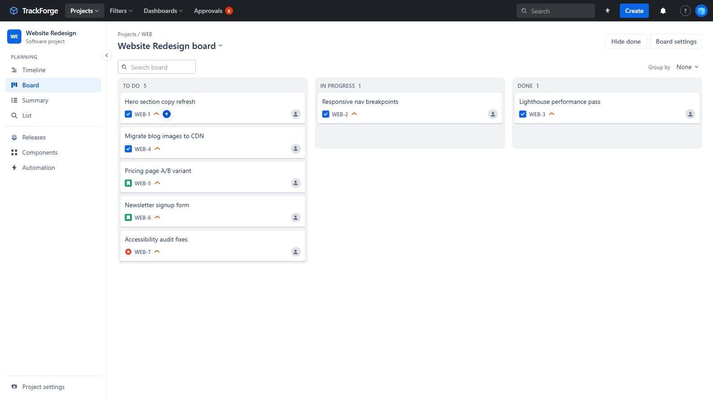
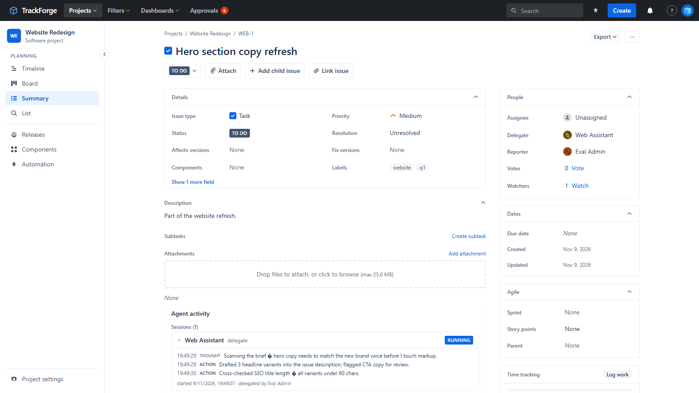
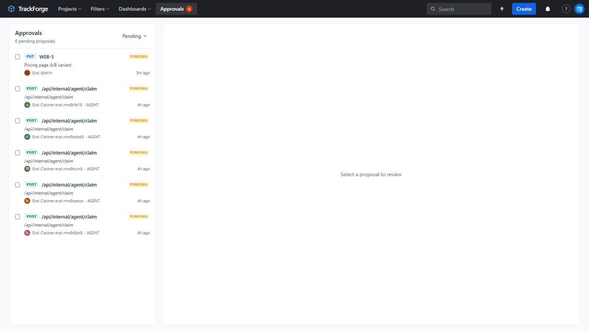
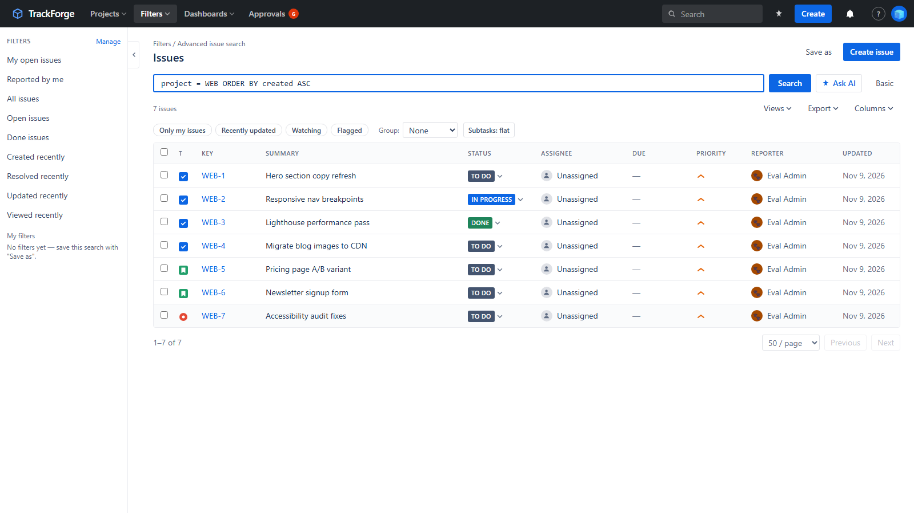
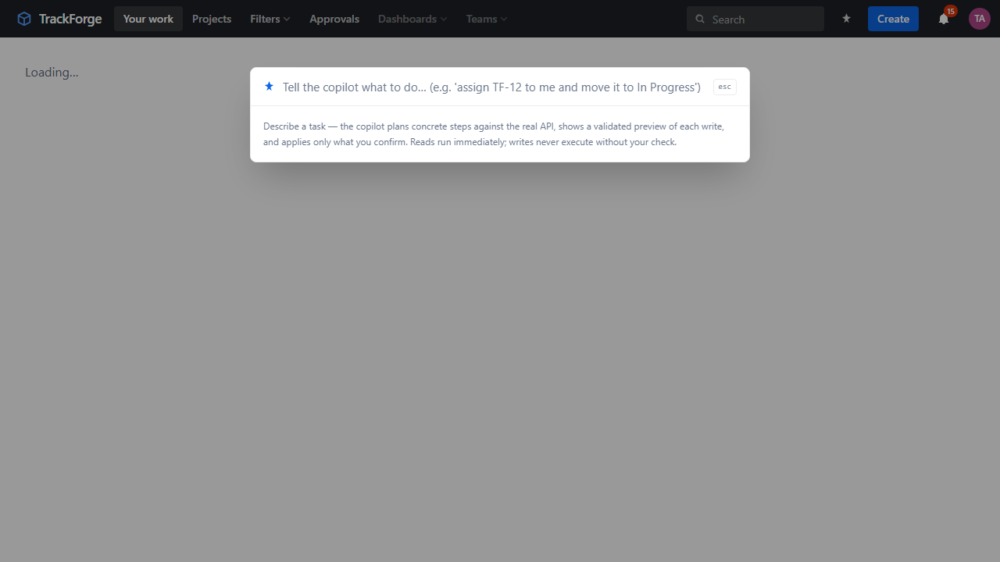

# TrackForge

Self-hosted issue tracker built so that **AI agents are first-class users** —
they authenticate with scoped PATs, drive the same REST API humans use, and
get a governed work loop (delegate → session → activities → questions) plus
a first-party MCP server. The API implements the Jira v2 REST contract, so
existing Jira-aware tooling can talk to it unchanged.

- PostgreSQL-backed, Express + React, one `docker compose up` for production.
- Jira v2 REST under `/rest/api/2`, agile under `/rest/agile/1.0`, plus a
  JQL-compatible query engine. Verified surface: `docs/compatibility.md`
  (CI-generated).
- Agent governance: dry-run previews, idempotent writes, per-token approval
  policies with editable proposals, immutable audit + attribution.



## Run it

```bash
cp .env.example .env            # set POSTGRES_PASSWORD, SESSION_SECRET, TF_ADMIN_*
docker compose -f docker-compose.prod.yml up -d   # builds from source
open http://localhost:3000      # log in as TF_ADMIN_EMAIL / TF_ADMIN_PASSWORD
```

Dev (hot reload, local toolchain):

```bash
docker compose up -d            # postgres :5433, redis, mailpit
pnpm install && pnpm db:seed
pnpm dev                        # backend :3000 + frontend :5173
```

Full guide: [`docs/install.md`](docs/install.md).

## Connect an agent (MCP)

```bash
# 1. mint a scoped PAT for the agent (shown once)
curl -X POST http://localhost:3000/api/internal/tokens \
  -H "Authorization: Bearer $ADMIN_TOKEN" -H "Content-Type: application/json" \
  -d '{"name":"agent","scopes":["read","write"]}'

# 2. run the MCP server over stdio
TRACKFORGE_URL=http://localhost:3000 TRACKFORGE_TOKEN=tfp_xxx \
  pnpm --filter trackforge-mcp dev
```

Streamable HTTP (`--http --port 3001`), a read-only toolset
(`--readonly` / `?toolset=readonly`), and the full tool list:
[`docs/mcp.md`](docs/mcp.md) · [`apps/mcp/README.md`](apps/mcp/README.md).
Agents can self-discover all of this from `GET /llms.txt`.

## What makes it different

| Capability | What you get |
|---|---|
| Jira API compat | Jira v2 response shapes, transitions-only status, JQL-compatible queries (`ready()`, `blocked()`, memberOf, linkedIssues…). Compat matrix generated from the live OpenAPI doc. |
| Agent work loop | `delegate` (≠ `assignee`), inspectable sessions, activity stream, blocking questions, stale-session sweep. |
| Ready-work + claim | `key in ready()` JQL, and `POST /api/internal/agent/claim` — atomic delegate+session (`SKIP LOCKED`), safe for agent fleets. |
| Write safety | `?dryRun=true` preview on every mutation, `Idempotency-Key` replay, two-step deletes with confirm tokens. |
| Governance | Per-token `approvalPolicy`: `never` / `destructiveOnly` / `always` → writes park as proposals, approvable *with edits* (revalidated at replay). |
| Attribution | `X-TrackForge-Channel` + token identity on every changelog entry and audit event. |

## Screenshots

| Agent working an issue | Governance inbox |
|---|---|
|  |  |

| JQL-compatible search | Copilot command palette |
|---|---|
|  |  |

## Docs

| | |
|---|---|
| Install | [`docs/install.md`](docs/install.md) |
| Architecture (Mermaid) | [`docs/architecture.md`](docs/architecture.md) |
| MCP setup | [`docs/mcp.md`](docs/mcp.md) |
| Agent integration | [`docs/agents.md`](docs/agents.md) |
| Jira compatibility | [`docs/compatibility.md`](docs/compatibility.md) |
| Positioning | [`docs/positioning.md`](docs/positioning.md) |
| Contributing | [`CONTRIBUTING.md`](CONTRIBUTING.md) |
| Security | [`SECURITY.md`](SECURITY.md) |
| Maintainer orientation | [`AGENTS.md`](AGENTS.md) |

## Support

- Bugs + feature requests: GitHub Issues on this repository.
- Vulnerabilities: **private** reports via GitHub Security Advisories — see
  [`SECURITY.md`](SECURITY.md). Do not file public issues for security reports.

License: not yet chosen — see the roadmap. Do not redistribute until decided.

---

Jira, JQL, and Atlassian are trademarks of Atlassian Corporation Pty Ltd.
TrackForge is an independent project — not affiliated with, sponsored, or
endorsed by Atlassian. Compatibility claims refer to the documented public
REST API surface only; no Atlassian code, assets, or documentation are
redistributed in this repository.
