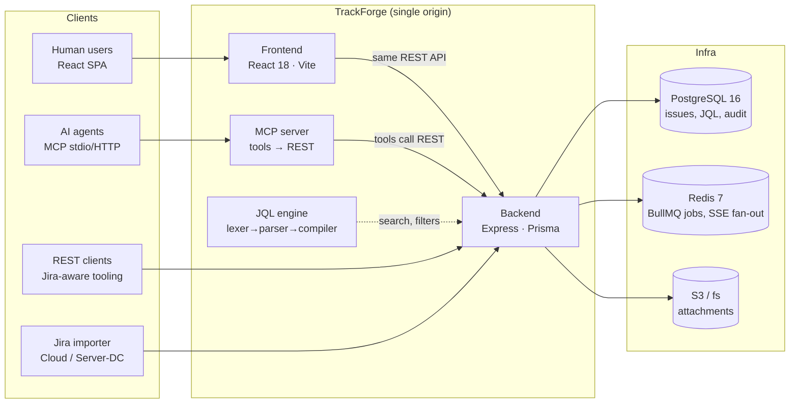
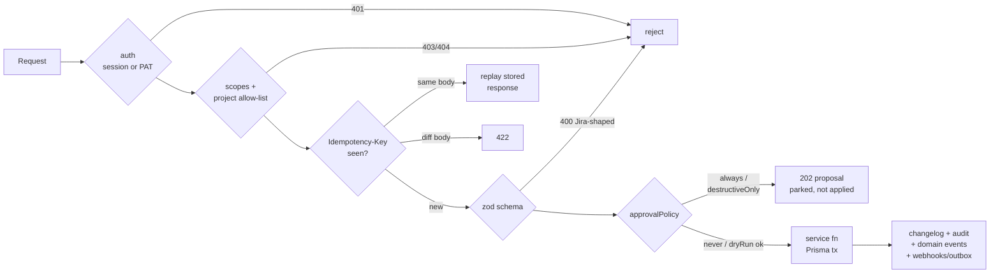
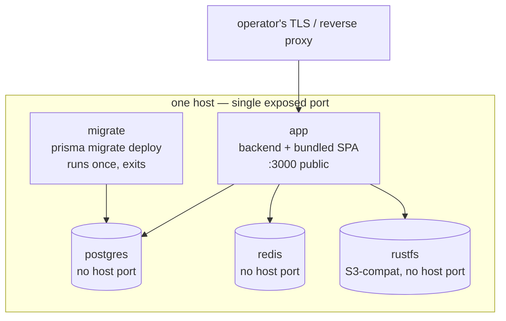

# Architecture — five-minute orientation

The system in four diagrams: who talks to it, what a request passes through,
how an agent works an issue, and what runs in production. For structural debt
and the refactor plan see `architecture-review-agentic.md`; for module-by-module
orientation see the repo's root `AGENTS.md`.

## 1. System context



Agents use the **same REST surface** as the UI — no privileged back door.
Their token scopes, project allow-lists, and approval policy apply identically.

## 2. Request pipeline (every mutation)



Two invariants worth remembering: **`PUT fields.status` is rejected** (status
moves via transitions only) and **destructive deletes are two-step**
(`dryRun` → `confirmToken` → delete).

## 3. Agent work loop

```mermaid
sequenceDiagram
    participant H as Human (assignee stays accountable)
    participant API as REST / MCP
    participant S as AgentSessionService
    participant AG as Agent
    H->>API: delegate = agent (or POST /agent/claim)
    API->>S: session opens (trigger: delegate|claim)
    S-->>AG: session + project guidance
    loop work
        AG->>API: emit_activity (thought|action|error)
        AG->>API: writes (dryRun / proposals apply per policy)
        opt needs a decision
            AG->>API: ask_user(question)
            S-->>H: notification
            H->>API: answer
            S-->>AG: resume (agent_question.answered)
        end
    end
    AG->>API: status = done (or failed)
    Note over S: stale sweep: no heartbeat → blocked;<br/>expired question → failed
```

`delegate` ≠ `assignee`: the human keeps accountability, the agent gets a
session. `POST /api/internal/agent/claim` does the pick-up atomically
(`FOR UPDATE SKIP LOCKED`) so fleets don't double-claim.

## 4. Production topology (`docker-compose.prod.yml`)



- `migrate` runs first; `app` waits for it (`service_completed_successfully`).
- Infra ports never publish — the only public port is the app's
  (install-smoke workflow asserts this).
- Attachments default to the `fs` volume; `ATTACHMENT_STORAGE=s3` switches to
  the bundled RustFS or any external S3.

## Module map

| Path | Holds |
|---|---|
| `apps/backend/src/routes/` | HTTP surface — parse + validate + delegate to services |
| `apps/backend/src/services/` | All domain logic + Prisma access |
| `apps/backend/src/middleware/` | auth/scopes/idempotency, proposal gate, rate limit |
| `apps/backend/src/jql/` | Self-contained engine: lexer → parser → AST → Prisma compiler |
| `apps/backend/src/import/` | Jira Cloud / Server-DC importers |
| `apps/mcp/` | MCP server (stdio + Streamable HTTP) — tools map to REST calls |
| `apps/frontend/` | React SPA — thin client over the same REST API |
| `scripts/` | Release-gate checks (audit, env parity, hygiene, docs claims, migration compat, restore drill) |
| `tests/smoke/` | Post-deploy smoke suite shared by deploy.yml and operators |
